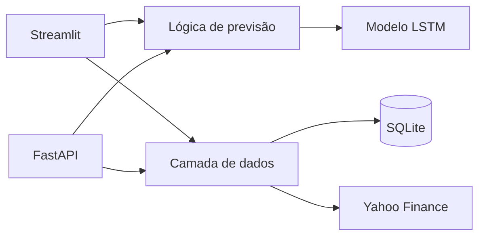

# Forecast BTC — Previsão de Bitcoin com LSTM

[](https://www.python.org/)
[](https://streamlit.io/)
[](https://fastapi.tiangolo.com/)
[](https://www.tensorflow.org/)
[](https://www.docker.com/)
[](https://github.com/andreluizpedroso/forecast-btc/stargazers)
[](https://github.com/andreluizpedroso/forecast-btc/commits/main)
[](https://forecastbtc-jisdg7mfjdwzjngbr6suwq.streamlit.app/)

Aplicação de Machine Learning que estima o próximo preço de fechamento do
Bitcoin (`BTC-USD`) com uma rede neural LSTM. O projeto oferece uma interface
Streamlit, uma API REST com FastAPI e um sinal experimental baseado no
cruzamento das médias móveis de 20 e 80 períodos.

> [!WARNING]
> Este projeto tem finalidade educacional. As previsões e os sinais exibidos
> não constituem recomendação de investimento.

## Demonstração

[Acessar a aplicação no Streamlit](https://forecastbtc-jisdg7mfjdwzjngbr6suwq.streamlit.app/)

Na interface, escolha uma data entre 1 e 30 dias após o último registro do
banco local. A aplicação exibe o preço estimado em dólar, as médias móveis e o
sinal **Comprar** ou **Aguardar**.

## Funcionalidades

- previsão recursiva de até 30 dias pela interface;
- endpoint para previsão com histórico informado pelo usuário;
- endpoint automático com dados recentes do Yahoo Finance;
- gráfico interativo de histórico, projeção, MM20 e MM80;
- persistência do histórico em SQLite;
- API documentada automaticamente com OpenAPI/Swagger;
- execução da API em container Docker;
- testes unitários da previsão, recomendação e camada de dados.

## Arquitetura



A interface e a API compartilham a mesma implementação. A janela temporal não
fica duplicada no código: ela é lida diretamente do modelo salvo, que atualmente
espera **10 preços de fechamento**.

```text
forecast_btc/
├── forecast_btc/
│   ├── api.py           # Rotas, contratos e dependências da API
│   ├── charts.py        # Construção dos gráficos Plotly
│   ├── config.py        # Constantes e caminhos do projeto
│   ├── data.py          # Acesso ao SQLite e Yahoo Finance
│   ├── forecasting.py   # Previsão e regras de negócio
│   └── model.py         # Carregamento e inspeção do modelo
├── tests/               # Testes automatizados
├── app.py               # Ponto de entrada do Streamlit
├── main.py              # Ponto de entrada ASGI
├── finance.db           # Snapshot do histórico
├── modelo_lstm.h5       # Modelo treinado
├── Forecast.ipynb       # Exploração e treinamento
├── Dockerfile
└── requirements.txt
```

## Tecnologias

- Python, Pandas e NumPy;
- TensorFlow/Keras e Scikit-learn;
- Streamlit e Plotly;
- FastAPI, Pydantic e Uvicorn;
- yFinance e SQLite;
- Docker.

## Instalação

Pré-requisitos: Python 3.10 ou superior e Git.

```bash
git clone https://github.com/andreluizpedroso/forecast-btc.git
cd forecast_btc
python -m venv .venv
```

Ative o ambiente virtual:

```powershell
# Windows PowerShell
.venv\Scripts\Activate.ps1
```

```bash
# Linux ou macOS
source .venv/bin/activate
```

Instale as dependências:

```bash
python -m pip install --upgrade pip
pip install -r requirements.txt
```

## Executando a interface

```bash
streamlit run app.py
```

Acesse [http://localhost:8501](http://localhost:8501). A data inicial da
previsão depende do registro mais recente presente em `finance.db`.

## Executando a API

```bash
uvicorn main:app --reload
```

A documentação interativa estará disponível em
[http://localhost:8000/docs](http://localhost:8000/docs).

### Endpoints

| Método | Rota | Descrição |
| --- | --- | --- |
| `GET` | `/` | Verifica se a API está online |
| `POST` | `/prever` | Prevê o próximo fechamento com o histórico enviado |
| `POST` | `/prever_auto` | Busca dados recentes no Yahoo Finance e prevê o próximo fechamento |

### Previsão manual

Envie pelo menos 10 preços em ordem cronológica:

```bash
curl -X POST http://localhost:8000/prever \
  -H "Content-Type: application/json" \
  -d '{"historico":[61234.10,61300.20,61190.80,61550.40,61780.00,61620.30,61990.10,62110.50,62040.70,62300.90]}'
```

Resposta:

```json
{
  "preco_previsto": 62184.32,
  "dias_usados": 10,
  "fonte": "Entrada manual"
}
```

O valor acima é apenas ilustrativo; a resposta real depende dos preços
enviados e do modelo disponível.

### Previsão automática

```bash
curl -X POST http://localhost:8000/prever_auto
```

Esse endpoint consulta o `BTC-USD` no Yahoo Finance e pode falhar caso o serviço
externo esteja indisponível.

## Docker

O container inicia a API FastAPI na porta 8000:

```bash
docker build -t forecast-btc-api .
docker run --rm -p 8000:8000 forecast-btc-api
```

Depois do início, acesse [http://localhost:8000/docs](http://localhost:8000/docs).

## Onde publicar?

A arquitetura atual precisa de um ambiente capaz de executar Python com as
dependências de Machine Learning do projeto. As opções recomendadas são:

| Componente | Plataforma sugerida | Observação |
| --- | --- | --- |
| Interface Streamlit | [Streamlit Community Cloud](https://streamlit.io/cloud) | Opção mais simples para executar `app.py` |
| API FastAPI | Render, Railway ou Google Cloud Run | Permitem publicar a API usando o `Dockerfile` |
| Aplicação completa | Render, Railway ou Google Cloud Run | Suportam TensorFlow e processos Python persistentes |

O Vercel é mais adequado para frontends leves e funções serverless. No build
testado, as dependências deste projeto ocuparam aproximadamente **2,48 GB**,
acima dos limites de 500 MB e 1 GB indicados pelo serviço. O principal impacto
vem do TensorFlow, somado às demais bibliotecas de análise e visualização.

Se o Vercel for adotado no futuro, a abordagem recomendada será hospedar nele
apenas um frontend em Next.js ou React, mantendo a API e o modelo em um dos
serviços com suporte a Docker listados acima.

## Testes

Os testes não precisam carregar o TensorFlow nem acessar a internet:

```bash
python -m unittest discover -v
```

## Modelo

- entrada: 10 preços de fechamento normalizados;
- arquitetura: uma camada LSTM com 64 unidades e uma camada densa;
- função de perda: erro quadrático médio (MSE);
- otimizador: Adam;
- saída: estimativa do próximo fechamento;
- previsões de vários dias: estratégia recursiva, reutilizando cada estimativa
  como entrada do passo seguinte.

O notebook `Forecast.ipynb` registra a exploração, preparação dos dados e o
treinamento. A aplicação utiliza diretamente o artefato `modelo_lstm.h5` e não
treina um novo modelo durante a inicialização.

## Limitações

- o modelo é univariado e considera apenas o preço de fechamento;
- volume, indicadores macroeconômicos, notícias e sentimento não são usados;
- previsões recursivas acumulam erro à medida que o horizonte aumenta;
- o sinal por médias móveis é uma regra simples, não uma estratégia validada;
- a interface usa o snapshot em `finance.db`, que precisa ser atualizado para
  acompanhar novos pregões;
- não há quantificação de incerteza nem intervalo de confiança;
- desempenho passado não garante resultados futuros.

## Fonte dos dados

[Yahoo Finance — Bitcoin USD (BTC-USD)](https://finance.yahoo.com/quote/BTC-USD/)

## Autor

**Andre Luiz Pedroso**

Projeto desenvolvido para a **Pós-Tech — Tech Challenge Fase 4 — Engenharia de
Machine Learning**.
